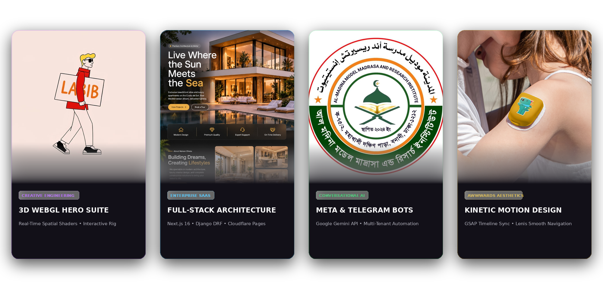

<div align="center">

# 💼 LABIB FOHAYER — Senior Full-Stack & AI Automation Engineer
### High-Performance Developer Portfolio & Interactive 3D Showcase

[](https://labibfohayer.pages.dev/)
[](https://nextjs.org/)
[](https://react.dev/)
[](https://greensock.com/gsap/)
[](https://lenis.darkroom.engineering/)
[](https://labibfohayer.pages.dev/)
[](LICENSE)

<br/>

**[⚡ View Live Production Portfolio](https://labibfohayer.pages.dev/)** &nbsp;•&nbsp; **[📦 GitHub Repository](https://github.com/labibfohayer/My-Portfolio)**

<br/>



</div>

---

## 📌 Architectural Overview

Welcome to the official digital portfolio of **Labib Fohayer**—Senior Full-Stack Developer and AI Automation Systems Architect. This platform serves as a high-performance demonstration of contemporary creative engineering, presenting commercial web platforms, autonomous AI pipelines, and bespoke client architectures.

The experience fuses editorial typography with hardware-accelerated motion choreography, achieving sub-second global time-to-first-byte (TTFB), continuous sub-frame scrolling via **Lenis**, and fluid page morphs.

---

## ⚡ Key Engineering Highlights

1. **Curated Commercial Case Studies:**
   - Interactive deep-dives into 15+ production applications (Maison Dhaka, Villa Solenne, Stack Shack, NAWABIYAAT, AMMS, BD Mess, Coffee Peyala).
   - Live production links, technical architecture breakdowns, and stack metrics.

2. **Creative 3D & Kinetic Choreography:**
   - Hardware-accelerated split-text typography and mouse-tracking spatial reveals using **GSAP** and **ScrollTrigger**.
   - Unified inertial kinematics across trackpads, wheels, and mobile touch surfaces.

3. **Integrated Resume Viewer & Media Pipeline:**
   - In-app interactive resume viewer with automated ATS-friendly PDF download generation.
   - High-fidelity media loading with zero layout shift and automatic WebP format selection.

---

## 🛠️ Tech Stack & Production Architecture

| Category | Technologies | Purpose |
| :--- | :--- | :--- |
| **Core Engine** | Next.js, React 19, TypeScript | Server-rendered performance and static edge generation |
| **Motion Physics** | GSAP 3, ScrollTrigger, Framer Motion | Timeline-driven cinematic entrance and exit choreographies |
| **Scroll Kinematics** | Lenis Inertial Smooth Scroll | Friction-free sub-pixel scrolling across all client viewports |
| **Styling & Assets** | Tailwind CSS, Lucide Vector Icons | Modular design system with dark-mode aesthetic standards |
| **Edge Distribution** | Cloudflare Pages, Edge KV, Workers | Global multi-zone low-latency edge deployment |

---

## 🚀 Local Development & Setup

```bash
# Clone the repository
git clone https://github.com/labibfohayer/My-Portfolio.git
cd My-Portfolio

# Serve locally
npx serve .
```

Open [http://localhost:3000](http://localhost:3000) to inspect the local deployment.

---

## 📄 License
This project is open-source and distributed under the [MIT License](LICENSE).
